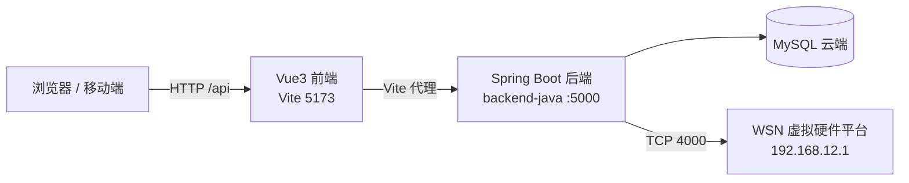
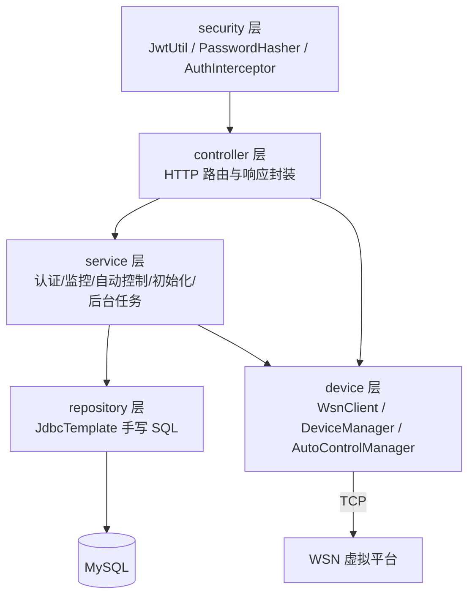

# 基于 Python 及 Vue 的智能农业管理系统

> **仓库根目录**：`基于python及vue的智能农业管理系统/`
> **主工程目录**：`smart_agriculture_system/`
> **Git 分支约定**：`main`（默认主分支，后续功能开发请拉分支）

本项目是一套"前端 Vue3 + 后端（Python Flask / Java Spring Boot 双实现）+ WSN 虚拟硬件控制器"的智能农业管理系统，覆盖环境监测、设备控制、历史数据、告警与自动控制、用户与权限管理等能力。

本 README 是**团队协作的唯一计划入口**：任何人调整排期、架构、接口或分工，必须**第一时间更新本文档的「改动计划」和「变更记录」**，然后再改代码，并通知队友。

---

## 1. 本次改动：我在做什么

**目标：保持原有功能与前端契约完全不变，把后端重构为 Java Spring Boot 实现。**

| 项 | 说明 |
| --- | --- |
| 新增工程 | `smart_agriculture_system/backend-java/`（独立 Maven 工程） |
| 技术栈 | Spring Boot 3.2.5 + `spring-boot-starter-web` + `spring-boot-starter-jdbc` + HikariCP + `mysql-connector-j` + 自研 JWT / PBKDF2 |
| 运行端口 | **5000**（与原 Flask 后端一致，前端 Vite 代理无需任何改动） |
| 数据库 | 沿用云端 MySQL，读取 `backend-java/.env` 中的 `DATABASE_URL`，Java 侧解析为 JDBC URL |
| 后端唯一实现 | Python Flask 后端（`backend/`）已按计划整体移除，Java 为唯一后端 |
| 未改动 | `frontend/`、`kv_wsn/` 均保持原样 |
| 交付物 | 可执行包 `backend-java/target/smart-agriculture-backend.jar` |

**已对齐的原有关键行为**

- 响应字段保持 `snake_case`，时间格式、状态码、错误文案与原 Flask 接口一致
- JWT 与原 `flask-jwt-extended` 使用同一 `JWT_SECRET_KEY`，令牌可互通；`access_token` 为纯字符串
- 兼容 werkzeug 密码哈希 `pbkdf2:sha256:260000$salt$hex`，历史密码与 `admin/admin123` 应急登录可用
- WSN TCP 协议帧（Ping / 继电器查询 / 继电器控制 / 传感器 `B5` 帧）逐字节一致，路径 `192.168.12.1:4000`
- 定时任务一致：传感器采集 120 s、自动控制 30 s、连接看门狗 600 s、启动异步连接 + 10 次 × 30 s 重连
- 设备状态更新策略与原实现一致：连接异常后不再对其余设备逐个重连，继电器缓存按当前设备状态初始化

**已实测通过**：登录 / refresh / profile、用户 CRUD 与权限、设备列表与状态、连接状态、实时传感器、历史数据与分页、告警列表与规则、自动控制开关与阈值、CSV 导出、404/401 等异常码。

> 当前现象：WSN 虚拟平台对相同协议帧会返回 `Connection reset`。已用原始 Python socket 发送完全相同的字节复测，同样被平台重置，**属于虚拟平台/网络侧问题，与后端语言无关**；Java 端与原 Python 端一样会回退到数据库最新值或默认值，接口不报错。

---

## 2. 队友需要做什么

### 2.1 立即要做（所有人）

1. 拉取本仓库，阅读本 README，确认自己的分工。
2. **不要提交**：`.env`、PPT、视频、压缩包、备份/失败目录、`node_modules`、`.venv`、`target`、日志（`.gitignore` 已覆盖）。
3. 本地启动前确认 5000 端口空闲（当前只有 Java 后端占用该端口）。

### 2.2 分工清单

| 角色 | 需要做的事 |
| --- | --- |
| 前端 | 无需改动现有页面；新增页面严格复用 `src/api/*` 与 `src/utils/request.js` 的约定（`{"error": ...}` / `{"message": ...}`、列表直接返回数组）。改动前先确认接口是否已在 Java 后端实现。 |
| Java 后端 | 在 `backend-java/` 内继续开发；补齐单元/集成测试；新增接口必须先更新本 README 的「接口与架构」再实现。 |
| Python 后端（已移除） | 代码已删除，仅保留在 Git 历史（提交 `f8b03f2`）供行为对照；不再维护、不新增功能。 |
| 硬件 / 联调 | 排查虚拟平台 `Connection reset`（平台侧配置、端口占用、并发连接、协议实现）；维护设备地址表（见 3.4）。 |
| 测试 / 文档 | 按「接口回归清单」补充用例；负责演示材料、部署文档与答辩素材（**不进仓库**）。 |

### 2.3 接口回归清单（提测前逐项勾选）

- [ ] 登录 / 刷新 / 个人资料 / 退出
- [ ] 用户列表、创建、修改、删除（admin 保护、不能删除自己、用户名/邮箱唯一）
- [ ] 设备列表、设备状态、连接状态、连接/断开、控制开/关
- [ ] 实时传感器、最新传感器、公开传感器接口
- [ ] 历史数据（分页、时间范围、指标筛选）、统计、CSV 导出
- [ ] 告警最近记录、处理、未处理计数、规则 CRUD、规则启停
- [ ] 自动控制状态、启停、阈值读写（min < max 校验）
- [ ] 未授权 / 无权限 / 不存在路径的状态码与文案

---

## 3. 软件架构设计

### 3.1 总体结构



### 3.2 技术栈

| 层 | 技术 |
| --- | --- |
| 前端 | Vue 3 + Vite + Element Plus + Pinia + ECharts + Axios |
| 后端（唯一实现） | Java 17 目标字节码 / Spring Boot 3.2.5 / JdbcTemplate / HikariCP / 自研 JWT（HS256） |
| 数据库 | MySQL（`users`、`sensor_data`、`device_status`、`operation_logs`、`threshold_settings`） |
| 硬件通信 | TCP Socket，WSN 自定义帧协议 |

### 3.3 Java 后端分层



- **controller**：只做参数校验、调用服务、组装响应，保持原接口的字段与状态码。
- **service**：业务编排；`Initializer` 负责建表与种子数据，`BackgroundTasks` 负责启动异步线程。
- **repository**：全部使用 `JdbcTemplate`，不引入 JPA/Hibernate，避免运行环境兼容风险。
- **device**：`WsnClient` 只负责协议字节与 Socket 读写；`DeviceManager` 负责状态与缓存；`AutoControlManager` 负责阈值控制循环。
- **security**：统一在 `AuthInterceptor` 完成鉴权（`/api/users/**` 需 admin；`/api/auth/profile|refresh` 需 token；告警规则写操作需 token）。

### 3.4 设备地址表

| 设备类型 | 名称 | 继电器地址 | 通道 |
| --- | --- | --- | --- |
| `external_shade` | 外遮阳 | `0x2001` | 1 |
| `internal_shade` | 内遮阳 | `0x2001` | 2 |
| `skylight` | 天窗 | `0x2003` | 1 |
| `spray` | 喷灌 | `0x2003` | 2 |
| `water_curtain` | 水帘 | `0x2003` | 3 |
| `light` | 补光灯 | `0x2003` | 4 |
| `external_fan` | 外风机 | `0x2001` | 3 |
| `internal_fan` | 内风机 | `0x2001` | 4 |

协议帧（十六进制）：Ping `A5 00 00 FF FF FF FF FF 5A`；状态查询 `A5 00 addr FF×5 5A`；继电器控制 `A5 20 addr s1 s2 s3 s4 FF 5A`；传感器上报 `B5 type addr data[5] 5B`（`0x31` 空气温湿度、`0x32` 土壤温湿度、`0x33` CO₂、`0x34` 光照）。

### 3.5 接口分区（前缀 `/api`）

| 分区 | 主要路径 | 说明 |
| --- | --- | --- |
| 认证 | `/auth/login`、`/register`、`/profile`、`/refresh`、`/logout` | 登录返回 `access_token` 字符串 |
| 用户 | `/users`、`/users/{id}` | 仅管理员可访问 |
| 设备 | `/device/devices`、`/status`、`/control`、`/connection-status`、`/connect`、`/disconnect`、`/sensor-data`、`/realtime-sensor-data`、`/public/sensor-data` | 控制与公开数据接口不鉴权 |
| 历史 | `/history/data`、`/history`、`/history/summary`、`/history/sensor-data` | 统一分页结构 `data + meta` |
| 告警 | `/alerts/recent`、`/alerts/handle/{id}`、`/alerts/count`、`/alerts/rules`、`/alerts/rules/{id}/toggle`、`/alerts/auto-control/...` | 规则写操作需 token |
| 自动控制 | `/auto-control/status`、`/enable`、`/disable`、`/thresholds` | 阈值键：`temperature/humidity/light/co2` |
| 兼容根路径 | `/sensor-data`、`/device/status`、`/device/connect`、`/api/sensor-data`、`/api/export/sensor-data` | 兼容旧前端与导出 |

---

## 4. 改动计划

> **规则**：计划有变动（范围、优先级、接口、分工、里程碑），先在本文档修改本节与第 7 节「变更记录」，再改代码，并在群里周知。

| 阶段 | 内容 | 状态 |
| --- | --- | --- |
| P0 | Java Spring Boot 后端等功权重构（接口、JWT、协议、定时任务、自动控制）；移除 Python Flask 后端 | ✅ 已完成 |
| P1 | 硬件联调：虚拟平台 `Connection reset` 定位与修复，确认真实设备行为 | 🔄 进行中 |
| P2 | 质量保障：接口回归脚本、关键服务单元测试、异常路径覆盖 | ⬜ 待开始 |
| P3 | 部署交付：配置外置（`.env` 不入库）、Docker/启动脚本、日志与健康检查 | ⬜ 待开始 |
| P4 | 文档与演示：部署说明、答辩材料、操作手册（材料不进仓库） | ⬜ 待开始 |

**当前约束（需团队确认后才可调整）**

1. 前端在本阶段不做功能改动；Python Flask 后端已移除，Java 后端是唯一实现，新能力只在 `backend-java/` 内开发。
2. 任何接口新增/字段变更，必须先改 README 的接口表，再同步前端同学。
3. 后端端口固定 5000；启动前需确认端口未被占用。

---

## 5. 项目工程组织形式

```
基于python及vue的智能农业管理系统/          # Git 仓库根
├── .gitignore                              # 忽略 PPT/视频/压缩包/备份/环境/构建产物
├── README.md                               # 本文件：计划、架构、分工（唯一计划入口）
├── 2025年…物联网设计大赛设计文档模板….docx   # 竞赛/课程文档
├── 第9组基于Python及Vue的智能农业管理系统.docx
├── 物联网应用系统设计课程设计.docx
├── 问题与解决方案.md                        # 历史问题记录
├── WPS图片(1).png
├── 智慧农业.ivms
└── smart_agriculture_system/               # 主工程
    ├── frontend/                           # Vue3 + Vite（5173，代理 /api → 5000）
    ├── backend-java/                       # Java Spring Boot 后端（唯一后端实现）
    │   ├── pom.xml
    │   ├── .env                            # 数据库与密钥（已被忽略，勿提交）
    │   └── src/main/java/com/smartagriculture/
    │       ├── controller/  service/  repository/  device/
    │       ├── security/  config/  model/  util/
    │       └── SmartAgricultureApplication.java
    ├── kv_wsn/                             # WSN 虚拟平台参考实现
    └── README.md                           # 原工程说明（后端已改为 Java）
```

**命名与提交约定**

- Java 包名统一 `com.smartagriculture.*`；类名按分层后缀（`*Controller` / `*Service` / `*Repository` / `*Manager`）。
- 提交信息建议 `类型(模块): 说明`，类型取 `feat|fix|refactor|docs|test|chore`，例如 `feat(device): 增加设备状态推送`。
- 分支模型（轻量）：`main` 保持可运行；功能分支 `feat/xxx`、修复分支 `fix/xxx`；合并前至少 1 人 Review。
- 计划/架构类改动走 `docs:` 提交，并只改 README 与文档，不夹带功能代码。

---

## 6. 本地运行

### 6.1 前端

```bash
cd smart_agriculture_system/frontend
npm install        # 或 pnpm install
npm run dev        # http://localhost:5173，/api 代理到 5000
```

### 6.2 Java 后端（唯一后端实现）

前置：JDK 17+（本机已验证 JDK 26）与 Maven；`smart_agriculture_system/backend-java/.env` 存在且可读（不入库，向负责人获取）。

```powershell
cd smart_agriculture_system/backend-java
$env:JAVA_HOME='C:\Users\ZhongKe\.jdks\openjdk-26.0.2.1'   # 按本机 JDK 路径调整
mvn package -Dmaven.test.skip=true
java -jar target/smart-agriculture-backend.jar
```

- 服务地址：`http://localhost:5000`
- 日志：`backend-java/logs/smart_agriculture.log`
- 启动时会自动 `CREATE TABLE IF NOT EXISTS` 并确保 `admin` 账号存在

---

## 7. 变更记录

| 日期 | 变更 | 负责人 |
| --- | --- | --- |
| 2026-11-04 | 初始化 Git 仓库；新增 `.gitignore`（忽略 PPT、视频、压缩包、备份/失败目录、虚拟环境、构建产物、`.env`、日志） | Agent |
| 2026-11-04 | 新增根目录 README：架构设计、改动计划、分工、工程组织与协作规范 | Agent |
| 2026-11-04 | Java Spring Boot 后端 P0 完成并实测（端口 5000，接口契约不变；`Connection reset` 已确认属虚拟平台侧） | Agent |
| 2026-11-04 | 主分支由 `master` 调整为 `main`，并合并远端初始提交；团队后续默认在 `main` 协作 | Agent |
| 2026-11-04 | `.env` 迁移至 `backend-java/.env`；Java 后端成为唯一实现，并完成构建与接口验证 | Agent |

> 变更记录只增不删；每次计划调整都要在此追加一行，并注明受影响的阶段（P0–P4）。
