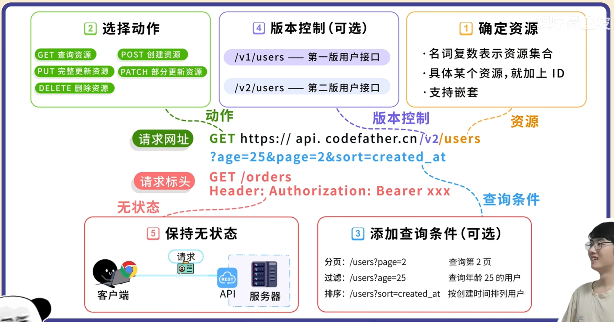

## RESTful API

一、**REST** 全称是 **Representational State Transfer（表现层状态转移）**。

- **资源（Resource）**：网络上的任何东西都可以是资源，比如一个用户、一篇文章、一张图片。

- **表现层（Representation）**：资源的具体表现形式，通常是 JSON 格式的文本。

- **状态转移（State Transfer）**：客户端通过 HTTP 动作（如 GET, POST），让服务器上的资源状态发生改变。

RESTful API 就是用 URL 来定位资源（指数据对象，包括用户、商品、文章等），用 HTTP 方法（POST,GET,PUT,DELETE）来操作资源，用 JSON 来传递数据。

二、 RESTful API 的 6 大核心设计原则
如果你要设计一个标准的 RESTful API，必须遵守以下规则：

1. 面向资源，使用名词（URL 中不能有动词）
   在 REST 中，URL 只负责“指明你要找什么”，不负责“你要对它做什么”。

   错误示范（包含了动词）：GET /api/getUsers 或 POST /api/deleteArticle

   &#32;正确示范（纯名词，通常用复数）：GET /api/users 或 DELETE /api/articles

2. 用 HTTP 方法（动词）表示操作
   既然 URL 只是名词，那怎么表达“增删改查”呢？用 HTTP 协议自带的方法！

   GET（获取）：从服务器读取资源。GET /users（获取所有用户），GET /users/1（获取 ID 为 1 的用户）。（安全且幂等：查询一万次，数据也不会变）

   POST（创建）：向服务器提交新资源。POST /users（创建一个新用户）。

   PUT（全量更新）：更新整个资源。PUT /users/1（把 ID 为 1 的用户信息全部替换）。

   PATCH（局部更新）：只更新资源的部分属性。PATCH /users/1（只修改该用户的密码）。

   DELETE（删除）：删除资源。DELETE /users/1（删除 ID 为 1 的用户）。（幂等：删一次和删一万次，结果都是该资源不存在）

3. 使用复数形式
   在命名资源路径时，统一使用复数，这样更符合逻辑。

✅ /api/users、/api/orders

❌ /api/user、/api/order

4. 利用 HTTP 状态码（Status Code）表达结果
   RESTful API 不应该把所有错误都包装在 200 响应里（比如 {"code": 500, "msg": "错误"}），而应该使用标准的 HTTP 状态码：

   200 OK：请求成功。

   201 Created：创建成功（配合 POST）。

   204 No Content：操作成功，但没有返回内容（比如 DELETE 成功）。

   400 Bad Request：客户端请求参数有误。

   401 Unauthorized：未登录或 Token 失效。

   403 Forbidden：已登录，但没有权限访问。

   404 Not Found：请求的资源不存在。

   500 Internal Server Error：服务器内部错误。

5. 过滤、排序与分页（不改变 URL 结构）
   当数据量很大时，不能把所有数据一次性返回。通常通过在 URL 后面加 查询参数（Query Parameters） 来实现：

   分页：GET /users?page=2&limit=20（获取第2页，每页20条）

   过滤：GET /users?status=active（只获取活跃用户）

   排序：GET /users?sort=-created_at（按创建时间倒序）

6. 无状态（Stateless）
   服务器不保存客户端的任何会话状态。每一次请求都必须包含服务器处理该请求所需的所有信息（比如每次请求都要带上 Token/JWT 用于身份验证）。服务器处理完请求就忘掉这个客户端。

---


### **RESTful API的好处**

1. 极佳的横向扩展能力（解决服务器压力）

   - **有状态（Session 模式）的痛点**：如果是传统模式，用户登录后服务器会把 Session 保存在内存里。当你的网站有 1 万用户时，一台服务器撑不住了，你需要加第二台服务器。这时候问题来了：用户在 A 服务器登录，下一次请求被路由到了 B 服务器，B 服务器没有他的 Session，就会要求他重新登录。你必须花大力气去搞“Session 共享”（比如存到 Redis 里），增加了架构复杂度。

   - **无状态（Token 模式）的优势**：服务器只负责验证 Token 的签名是否正确，不保存任何用户状态。你可以随便加 10 台、100 台服务器，用户的请求打到任意一台机器上都能被正确处理，极其适合做负载均衡和弹性扩容。

2. 跨端支持与前后端彻底分离

   - **原生 App 与微信小程序**：传统的 Cookie + Session 机制主要依赖浏览器的行为（自动携带 Cookie），但在 Android、iOS App 或小程序里，并没有原生的 Cookie 概念。使用 Token，只需把它放在 HTTP 请求头（Header）里发送，完美适配所有客户端平台。

   - **跨域问题（CORS）**：在前后端分离架构中（比如 Vue 前端跑在 8080 端口，后端跑在 3000 端口），浏览器对 Cookie 的跨域限制非常严格。而 Token 放在 Header 里，配合 CORS 配置，可以非常轻松地跨域访问。

3. 支持分布式微服务架构

   - 在微服务架构下，一个操作可能需要经过网关、用户服务、订单服务、库存服务等好几个模块。

   - 如果是 Session 模式，每个微服务都要去查这个 Session 是否有效（或者都去连同一个 Redis），网络开销巨大。

   - 如果是无状态 Token（比如 JWT），网关验证完签名后，直接把包含用户身份信息的 Token 传给下游服务，下游服务自己解析一下 Token 就知道是谁在请求，极大地减轻了认证中心的压力。

4. 避免CSRF（跨站请求伪造）攻击

   - 传统的 Session 依赖浏览器的 Cookie，很多浏览器默认会自动携带 Cookie，这就给了黑客可乘之机（诱导你点击一个链接，浏览器自动带着你的 Cookie 发送恶意请求）。

   - 而 Token 通常需要前端开发者手动提取，并放在请求头（`Authorization: Bearer <token>`）里。黑客的伪造链接无法自动让浏览器添加这个自定义的 Header，从根本上防范了 CSRF 攻击。

5. 节省服务器内存开销

   - 当并发用户达到百万级时，服务器要维护这几百万个用户的 Session，会占用极其惊人的内存。

   - 无状态模式下，服务器只做纯计算（解密校验 Token），不需要存任何东西，大大节省了服务器的内存资源。

---

### 无状态的代价与解决方法

然好处很多，但无状态也有一个痛点：**主动踢人下线很难**。\
因为服务器不记录状态，Token 一旦发出去，在过期时间（比如 7 天）内，哪怕你修改了密码、或者管理员想封禁你，服务器默认是拦不住的。

**业界常用的解决办法：**

1. **黑名单机制（Redis）**：用户登出或封号时，把这个 Token（或它的唯一 ID）加入 Redis 黑名单，并设置过期时间（和 Token 剩余时间一致）。虽然引入了 Redis，但仅仅是查询一下黑名单，比存海量 Session 要好得多。

2. **Token 双令牌机制（Access Token + Refresh Token）**：

   - **Access Token**：有效期极短（如 15 分钟），用于日常请求，就算被盗，损失也很小。

   - **Refresh Token**：有效期长（如 7 天），存在服务器（数据库），专门用来刷新 Access Token。如果用户被拉黑，服务器拒绝给他发新的 Access Token，他最多只能再嚣张 15 分钟。

### 我们的项目中

我们的项目中使用的是一小时有效token，过期后在下一次碰到需要鉴权的端口会被401打回，重新验证登录。

<p align="center">
  
</p>

来自b站up主：程序员鱼皮

---

## JDBC

**JDBC（Java Database Connectivity，Java 数据库连接）** 是 Java 语言中用来**连接和操作数据库的一套标准 API（应用程序接口）**。

简单来说，它就是 Java 程序员用来和数据库对话的“翻译官”和“电话线”。

1. 为什么需要 JDBC？
   假设你要去不同的国家（不同的数据库），你需要和当地人交流。

   如果没有 JDBC：你每去一个国家，都要重新学一门当地语言（为每一种数据库写一套专门的连接代码）。如果要换数据库，你的代码得全部重写。

   有了 JDBC：JDBC 就像是一个“国际标准翻译官”。你只需要对翻译官说中国话（标准的 Java 代码），翻译官会自动把它翻译成英语或法语（数据库能听懂的底层驱动协议）。

   JDBC 的核心思想是：面向接口编程。
   Java 官方（Sun 公司）只制定了一套标准的接口（Connection、Statement、ResultSet 等），至于底层的网络是怎么连的、数据是怎么传的，Java 官方不管。各大数据库厂商会提供自己的“驱动包（Driver）”，来实现这些接口。

2. JDBC 的核心四大组件
   在 Java 中，使用 JDBC 操作数据库，永远离不开这四个核心对象：

   - DriverManager（驱动管理器）：负责加载各个数据库的驱动，并“拨号”建立连接。

   - Connection（连接）：代表你和数据库之间的一条“电话线”。所有的操作都在这个连接上进行。

   - Statement / PreparedStatement（语句对象）：负责把你要执行的 SQL 语句（如 SELECT * FROM users）发送给数据库。

   - ResultSet（结果集）：如果发的是查询语句，数据库返回的数据表格就会装在这个对象里，你需要遍历它来拿到具体数据。

在没有使用任何框架（如 MyBatis、Hibernate）的远古时代，或者在现代框架的底层，代码极其繁琐，没有连接池，数据转换也麻烦。

```java
// 1. 加载数据库驱动（Java 6 之后通常可省略）
Class.forName("com.mysql.cj.jdbc.Driver");

// 2. 获取数据库连接
// (url, 用户名, 密码)
Connection conn = DriverManager.getConnection("jdbc:mysql://localhost:3306/testdb", "root", "123456");

// 3. 创建 Statement 对象
String sql = "SELECT * FROM users WHERE age > ?";
PreparedStatement pstmt = conn.prepareStatement(sql);
pstmt.setInt(1, 18); // 填入 SQL 中的问号参数

// 4. 执行 SQL，获取结果集
ResultSet rs = pstmt.executeQuery();

// 5. 遍历结果集，提取数据
while (rs.next()) {
    System.out.println("用户名：" + rs.getString("username"));
}

// 6. 释放资源（先开后关，极其重要！）
rs.close();
pstmt.close();
conn.close(); 
```


---

## JJWT

JJWT 是专门给 Java 和 Android 开发者用的库，它把底层极其复杂的：Base64 编码、HMAC SHA256 加密、RSA 非对称加密、JSON 序列化等操作全部封装好了，让你只需要写两三行代码，就能生成或验证 Token。

它主要用来**生成和验证 Token**，帮你实现用户登录认证。它封装了底层的加密、编码细节，让你用几行代码就能创建或解析一个安全的 JWT。

### 具体如何使用？

1. 签发Token

   ```java
   import io.jsonwebtoken.Jwts;
   import io.jsonwebtoken.security.Keys;
   import javax.crypto.SecretKey;
   import java.util.Date;
   
   // 1. 准备一个绝对安全的密钥（至少 256 位，即 32 个字符）
   // 实际开发中，这个密钥要写在配置文件里，绝对不能在代码里写死！
   String secretString = "mySuperSecretKeyForIoTProject2026!!";
   SecretKey key = Keys.hmacShaKeyFor(secretString.getBytes());
   
   // 2. 生成 Token
   String jwt = Jwts.builder()
           .subject("userId_10086")       // 设置主题（通常是用户 ID）
           .claim("role", "admin")        // 添加自定义数据（比如用户角色）
           .issuedAt(new Date())          // 签发时间
           .expiration(new Date(System.currentTimeMillis() + 86400000)) // 过期时间（这里设置 1 天）
           .signWith(key)                 // 使用密钥进行签名（默认 HS256 算法）
           .compact();                    // 生成最终的字符串
   
   System.out.println(jwt); 
   // 输出类似于：eyJhbGciOiJIUzI1NiJ9.eyJzdWIiOiJ1c2VySWRfMTAwODYi...（很长一串）
   ```

2. 解析并验证Token

   ```java
   import io.jsonwebtoken.Claims;
   import io.jsonwebtoken.Jwts;
   import io.jsonwebtoken.JwtException;
   
   try {
       // 使用同一把密钥来解析
       Claims claims = Jwts.parser()
               .verifyWith(key)           // 传入密钥进行验签
               .build()
               .parseSignedClaims(jwt)    // 传入要解析的 Token
               .getPayload();             // 获取里面的数据（Payload）
   
       // 如果没抛异常，说明 Token 是真实的且没过期
       String userId = claims.getSubject();
       String role = claims.get("role", String.class);
       
       System.out.println("验证通过！用户ID: " + userId + ", 角色: " + role);
   
   } catch (JwtException e) {
       // 如果签名不对、或者过期了，就会抛出异常
       System.out.println("Token 无效或已过期: " + e.getMessage());
   }
   ```

### 核心机制

JJWT 生成的那个长字符串，是由三部分用 `.` 隔开的：

1. **Header（头部）**：包含了算法信息（如 `{"alg": "HS256"}`）。JJWT 自动帮你生成。

2. **Payload（载荷）**：存放有效信息的地方（如用户 ID、过期时间）。就是你 `.claim()` 写进去的那些。

3. **Signature（签名）**：这是**最核心的防伪标志**。JJWT 会用你提供的 `key` 和 Header+Payload 进行加密计算，生成一串签名。

   - **防篡改**：如果有人截获了 Token，试图把 `role` 改成 `super_admin`，那么 Payload 变了，签名就对不上了。你的服务器解析时就会抛出 `SignatureException`，拒绝访问。

---

## 一些专业性名词

### 看门狗

软件进程卡死或停滞超过规定时间会强制干预，自动重启。

---

### 连接池

系统启动时，提前建立好 N 个数据库连接，放在一个“池子”里。当有用户请求需要查数据库时，直接从池子里拿一个现成的连接用，用完不关闭，而是**还回池子里**，留给下一个请求用。

1. 核心参数

   - **最小连接数 (Min Pool Size)**：不管有没有人用，池子里至少保留几个连接（比如 5 个），防止突发流量时来不及建连。

   - **最大连接数 (Max Pool Size)**：池子里最多允许有几个连接（比如 50 个）。**这个参数极其重要**，如果设得太大，会把数据库直接压垮（数据库通常有最大连接数限制）。

   - **超时时间 (Timeout)**：如果没拿到连接，最多等多久（比如 3000 毫秒），超时就报错。

   - **空闲存活时间**：一个连接闲置多久后会被自动销毁（因为数据库也有自己的“闲置断开”机制）。

2. 常见逐流连接池组件

   **Java 生态**：

   - **HikariCP**：目前 Java 界**性能最强、速度最快**的连接池，也是 Spring Boot 2.0+ 之后的默认选）。

   - **Druid**：阿里开源的连接池，除了基础功能，它还自带强大的 SQL 监控、防火墙等高级功能，国内用的非常多。

   - **C3P0** 和 **DBCP**：非常古老，现在基本被淘汰了。

   **Node.js 生态**：

   - `mysql2` 或 `pg` 自带的 Pool 模块。

   **Python 生态**：

   - `SQLAlchemy` 自带的连接池、`DBUtils` 等。

   **Go 生态**：

   - 标准库 `database/sql` 原生就自带强大的连接池管理。

---

### 线程池

1. 为什么要用线程池？
   没有线程池：
   假设你的服务器是一个快递站，每来一个包裹（用户请求），老板（操作系统）就去人才市场招一个临时工（创建线程），教他怎么打包，打完包后直接开除（销毁线程）。
   对应到代码里：在 Java 中，每次 new Thread().start() 都需要向操作系统申请内存、分配资源。如果一秒来 1 万个请求，系统光是“招人”和“开人”就累死了，根本没时间干活。

2. 有了线程池：
   老板提前雇了 10 个长期工（创建 10 个线程）在车间里喝茶。当包裹（任务）来的时候，直接扔给空闲的工人去干。干完之后工人不辞退，继续喝茶，等待下一个包裹。
   对应到代码里：系统启动时，预先创建好一定数量的线程（核心线程），放入一个“池子”里。当有任务提交时，从池子里拿一个空闲线程去执行。执行完毕后，线程不销毁，而是回到池子里等待新任务。

3. 线程池的“三条核心流水线”
   当你向线程池扔一个任务时，它会按以下顺序处理：

   核心员工（核心线程数 CorePoolSize）：池子里固定有 5 个员工。任务来了，这 5 个人谁闲着谁干。

   排队等待（任务队列 BlockingQueue）：如果这 5 个人都在忙，新来的任务不会立刻去招人，而是被扔进一个“待处理框”（队列）里排队。

   临时工（最大线程数 MaximumPoolSize）：如果待处理框也满了（比如排了 100 个任务），老板急了，就会临时招几个临时工（扩容线程），直到总人数达到最大限制（比如 10 个人）。

4. 拒绝策略（RejectedExecutionHandler）：如果 10 个人都在干，排队框也彻底爆满了。这时候如果还有任务来，老板只能翻脸（拒绝策略）——要么直接丢弃任务，要么报错，要么让提交任务的那个人自己看着办（抛回给调用者）。

   如果一段时间没任务，临时工会被开除（闲置销毁），只留下那 5 个核心员工。

5. 为什么需要线程池？
   降低资源消耗：复用已有的线程，避免了频繁创建和销毁线程带来的系统开销（创建线程是很重的操作，需要分配独立的内存栈）。

   提高响应速度：任务来了直接有现成的线程干活，不需要等待线程创建的时间。

   提供可管理性：如果不限制线程数量，无限制地创建线程（比如瞬间创建 10 万个），会导致 CPU 为了“切换线程”疯狂损耗，甚至导致内存溢出（OOM），直接把服务器搞宕机。线程池可以限制并发数量，起到保护系统的作用。

spring boot中的代码：

```java
@Configuration
@EnableAsync
public class ThreadPoolConfig {
    @Bean("taskExecutor")
    public ThreadPoolTaskExecutor taskExecutor() {
        ThreadPoolTaskExecutor executor = new ThreadPoolTaskExecutor();
        executor.setCorePoolSize(10);      // 核心线程数（常驻10个员工）
        executor.setMaxPoolSize(50);       // 最大线程数（最多50个员工）
        executor.setQueueCapacity(200);    // 队列容量（最多排队200个任务）
        executor.setKeepAliveSeconds(60);  // 临时工闲置60秒后开除
        executor.setThreadNamePrefix("IoT-Task-"); // 方便日志排查
        executor.initialize();
        return executor;
    }
}
```

在实际开发中，**线程池的数量设多少最合适？** 这是一个面试必考题：

- **CPU 密集型任务**（如复杂计算、视频渲染）：线程数 = CPU 核数 + 1。因为计算任务很吃 CPU，开多了反而导致频繁切换上下文。

- **I/O 密集型任务**（如读写数据库、网络请求——**你的温室项目就是这种**）：线程数 = CPU 核数 \* 2 或更大。因为线程大部分时间都在等网络或硬盘，CPU 是闲着的，多开点线程可以充分压榨 CPU。

---

### BCrypt

**BCrypt** 是一种专门为**密码存储**设计的密码哈希加密算法。

在软件开发中，保护用户密码的安全是重中之重。BCrypt 是目前业界公认的最安全的密码哈希算法之一，被广泛应用于各大互联网公司的后端系统中。

**一、 为什么不用 MD5 或 SHA-256？（背景痛点）**

很多初学者会想，密码加密还不简单？用 MD5 或者 SHA-256 把密码转成一串乱码不就行了？**不行，因为现在的黑客太强了。**

1. **彩虹表攻击**：MD5 计算速度极快。黑客把字典里所有常见的密码（如 123456、password）都计算成 MD5 值，建一个庞大的数据库（彩虹表）。你存的 MD5 值，黑客一查表就知道明文密码是什么。

2. **GPU 暴力破解**：现在的显卡算力恐怖，一秒钟能计算几十亿次 MD5。就算你加了复杂的密码，也扛不住这种速度。

**为了解决这个问题，BCrypt 诞生了。**

**二、 BCrypt 的两大“杀手锏”**

1. 自带“盐”（Salt）
   什么是盐：就是在你输入的密码前面或后面，随机拼接一段字符串，然后再去加密。

   BCrypt 的做法：每次调用 BCrypt 加密同一个密码（比如 123456），它都会随机生成一个独一无二的盐。这意味着，哪怕一万个用户的密码都是 123456，他们存在数据库里的哈希值也完全不同。黑客辛辛苦苦搞出来的“彩虹表”直接就废了。

   更妙的是：BCrypt 会把这个“盐”直接打包隐藏在它生成的哈希字符串里。你不需要在数据库里额外建一个字段去存盐，验证密码时，BCrypt 会自己从字符串里把盐提取出来。

2. 故意“慢”（计算成本/Work Factor）
   设计理念：对于正常业务，验证密码慢个 0.1 秒用户根本感觉不到；但对于试图暴力破解的黑客来说，每一次尝试都要耗费大量的算力和时间，这直接让他们破产。

   工作因子（Work Factor）：BCrypt 允许你调整计算强度。你可以设置计算复杂度，比如设为 10（默认），它就会进行 
   2
   10
   2 
   10
   （1024）轮迭代计算。设为 12，就是 4096 轮。你可以根据服务器硬件性能，把每次加密的时间控制在 100 毫秒左右，让暴力破解变得毫无意义。

**三、 BCrypt 的哈希值长什么样？**
BCrypt 加密后生成的字符串通常是 60 个字符长，非常有规律。比如：
$2a$10$N9qo8uLOickgx2ZMRZoMyeIjZAgcfl7p92ldGxad68LJZdL17lhWy

它分为四个部分（用 $ 隔开）：

$2a$：代表 BCrypt 算法的版本号。

$10$：这就是工作因子（Cost），表示进行了 
2
10
2 
10
轮哈希。

N9qo8uLOickgx2ZMRZoMye：这是随机生成的盐（Salt）。

IjZAgcfl7p92ldGxad68LJZdL17lhWy：这是最终计算出来的哈希值（密文）。

**四、 代码中怎么用？（以 Java Spring Boot 为例）**

在 Java 生态中，BCrypt 通常包含在 **Spring Security** 框架里。即使你不用整个 Spring Security，也可以单独引入它的加密模块。

1. 引入依赖

   ```xml
   <dependency>
       <groupId>org.springframework.security</groupId>
       <artifactId>spring-security-crypto</artifactId>
   </dependency>
   ```

2. 加密

   ```java
   import org.springframework.security.crypto.bcrypt.BCryptPasswordEncoder;
   
   // 创建 BCrypt 编码器（默认工作因子为 10）
   BCryptPasswordEncoder encoder = new BCryptPasswordEncoder();
   
   String rawPassword = "myPassword123"; 
   // 对明文密码进行加密
   String hashedPassword = encoder.encode(rawPassword); 
   
   // 存入数据库：$2a$10$... (每次运行生成的都不一样)
   System.out.println(hashedPassword);
   ```

3. 验证

   ```java
   // 假设 user 是从数据库里查出来的，里面存了以前生成的哈希值
   String storedHash = user.getPassword(); // 数据库里的 $2a$10$...
   String inputPassword = "myPassword123"; // 登录页面上用户输入的
   
   // 验证：BCrypt 会从 storedHash 中提取盐，然后对 inputPassword 进行加密，对比结果是否一致
   boolean isMatch = encoder.matches(inputPassword, storedHash);
   
   if (isMatch) {
       System.out.println("登录成功！");
   } else {
       System.out.println("密码错误！");
   }
   ```

---

### WebGL

**WebGL（Web Graphics Library，Web 图形库）** 是一种 JavaScript API，它允许你在**不需要安装任何插件**的情况下，直接在浏览器中渲染高性能的 2D 和 3D 图形。如果你之前了解过 **Three.js**，可以这么说，**Three.js 是建立在 WebGL 之上的“豪华装修包”，而 WebGL 是底层的地基。**

在 WebGL 出现之前，网页里只能放 2D 的图片和文字。如果你想在网页上显示一个 3D 的旋转地球，或者玩一个 3D 网页游戏，你必须下载安装 Flash 或 Unity Web Player 的插件。这不仅卡顿，还有极大的安全风险。

WebGL的出现打破了浏览器的限制，让 JavaScript 可以直接和电脑的<strong>显卡（GPU）</strong>对话。它就像一座桥梁，把显卡极其强大的并行计算和图形渲染能力，直接借给了网页使用。

#### **一、为什么不用纯WebGL，而是用Three.js？**

**因为直接写 WebGL 简直是在“地狱模式”写代码。**

在原生 WebGL 中，如果你想画一个简单的正方体，你需要手动写几十行 C 语言风格的顶点着色器和片元着色器代码、手动计算正方体的 8 个顶点坐标、手动处理矩阵变换（平移、旋转、缩放）、手动加载纹理（图片）并处理坐标系翻转、自己写光照算法......十分繁琐。

而Three.js 把这些极其繁琐的底层操作全部封装成了简单的 JavaScript 对象。

写Three.js代码，通过WebGL接口去指挥电脑的显卡进行渲染和计算，WebGL是底层技术，Three.js是一个3D库。

#### 二、WebGL的优缺点

**优点：**

- **零插件**：只要有浏览器就能跑，手机、电脑跨平台兼容。

- **极其高效**：利用 GPU 硬件加速，能跑得动几百万面的复杂 3D 模型。

- **交互性强**：可以直接用鼠标、键盘和 3D 场景进行互动。

**缺点：**

- **学习曲线极陡**：原生 WebGL 涉及大量的线性代数（矩阵、向量）和图形学知识。

- **内存和性能限制**：毕竟运行在浏览器沙盒里，不能像电脑里的本地游戏那样无限制地占用内存。

- **无法完全防止代码被看穿**：前端代码是公开的，如果你在里面写了核心的渲染逻辑，别人是可以扒下来的。

---

### Vite5

**本质是一个工程化脚手架和打包工具**。

**作用**：它不关心你页面上写了什么字，它只关心怎么把你的代码变成浏览器能认识的格式，并且跑得飞快。它分为两部分：

- **开发时**：提供一个极速的本地服务器，你改了代码，浏览器瞬间刷新。

- **上线时**：把所有的 Vue 代码、CSS、图片压缩合并，打包成几个小文件，丢给服务器。

**如果没有它，你得手动配置极其复杂的 Webpack，忍受漫长的启动时间。

平时写代码时，都在写 Vue，但当你按下保存，或者在终端敲 `npm run dev` 或 `npm run build` 时，干活的全是 Vite。

---

### Element Plus

一个UI组件库，直接用现成的漂亮按钮和表格。

---

### ECharts

用来画折线图。

---

### TCP长连接

**TCP 连接**是两台机器之间建立的一条可靠通信通道。**长连接**是指这条通道建立后**一直保持不关闭**，双方可以反复收发数据，而不是每次通信都"建立连接→发数据→断开"（短连接）。连接建立后**一直挂着**，网关有新数据就通过这条连接推给平台。

**为什么用长连接？** 物联网场景里设备/网关需要**实时、频繁**地双向通信。如果每次都用短连接，频繁握手开销大、延迟高，而且网关无法主动"推送"数据给平台。长连接让网关可以随时上报，平台也能随时下发。

---

### WSN_HOST

`WSN_HOST` 就是**网关（WSN 网关）的主机地址**，即平台要去连接的目标 IP 或域名。

- 在项目里是 `10.42.37.121`

- 它是"平台连接网关"时用的**地址配置项**

---

### WSN_PORT

`WSN_PORT` 就是网关监听的**端口号**。平台连接 `WSN_HOST:WSN_PORT` 才能找到网关上的服务。项目里是 `4000`

---

### JdbcTemplate

JdbcTemplate 是 **Spring 框架**提供的一个核心类，用来**简化 Java 直接操作数据库（JDBC）的繁琐代码**。你可以把它理解成一个“数据库操作助手”：你只需要告诉它“执行什么 SQL、传什么参数”，剩下的连接管理、异常处理、资源关闭等都由它包办。

- **轻量级**：它不是像 Hibernate 或 MyBatis 那样的完整 ORM 框架，本质上只是对 JDBC 的一层薄封装。你依然需要自己写 SQL，对 SQL 有完全的控制权。

- **异常转换**：它会把 JDBC 原生的 `SQLException` 转换成 Spring 统一的 `DataAccessException` 体系，让错误处理更清晰。<a href="https://docs.spring.io/spring-framework/docs/5.3.11/javadoc-api/org/springframework/jdbc/core/JdbcTemplate.html"></a><a href="https://docs.spring.io/spring-framework/docs/6.1.20/javadoc-api/org/springframework/jdbc/core/JdbcTemplate.html#queryForList(java.lang.String,java.lang.Object...)"></a>

- **依赖数据源**：使用前需要给它配置一个 `DataSource`（数据库连接池），它本身不负责管理连接池。

---

